# Perihelion

**You are the gravity.** A daily puzzle that lives on your desk: sling a comet into the ring, and when no
path exists, make one — pinch the air to plant gravity, or set your coffee mug where a planet should be.

- **Play:** https://perihelion-three.vercel.app (open in the Meta Quest browser, tap *Play on your desk*)
- **No headset?** The same link plays in a desktop browser with the mouse, or with your real hands over a
  webcam (`?camera=1`). See [playtesting](docs/PLAYTEST.md).
- **Built for:** Meta VR Start Developer Competition 2026 — Gaming track, New Experience
- **Built with:** [Immersive Web SDK](https://developers.meta.com/horizon/documentation/iwsdk/guides/overview/) 1.1 (WebXR, Three.js, ECS), TypeScript, Vite

| Black hole, moon on its track | A real cup with gravity |
|---|---|
| 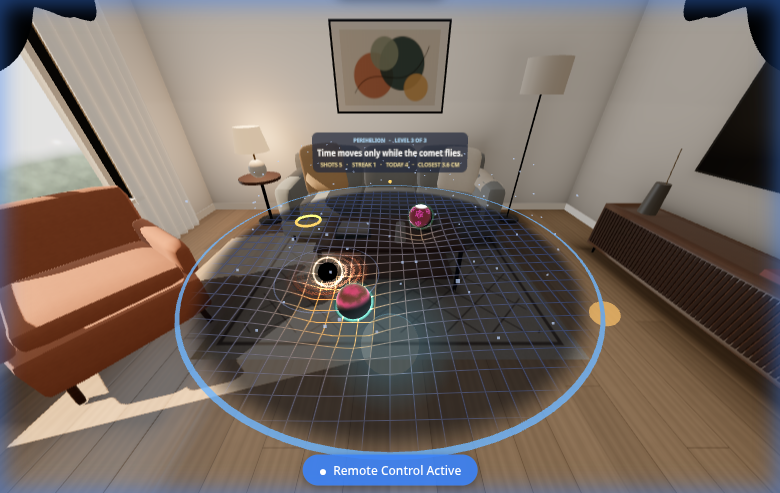 | 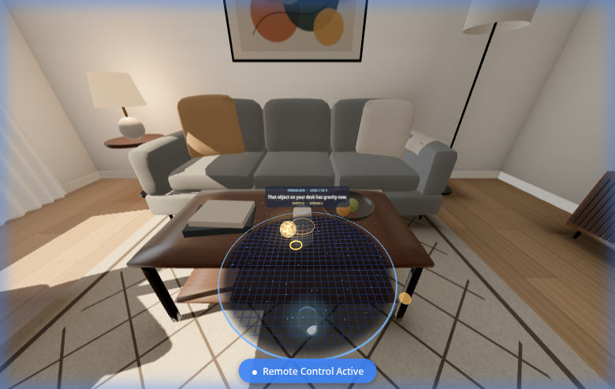 |

| Empty sky: planted gravity bends the path (desktop play) | Narrowest device view |
|---|---|
| 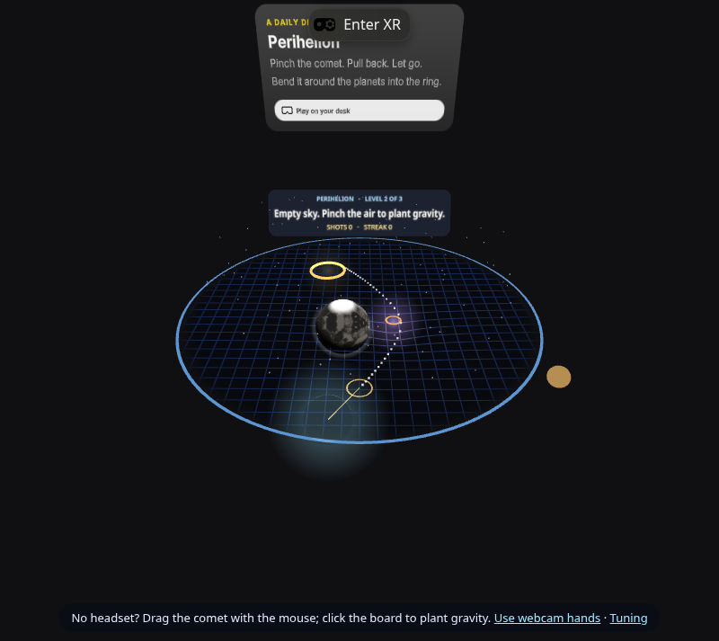 | 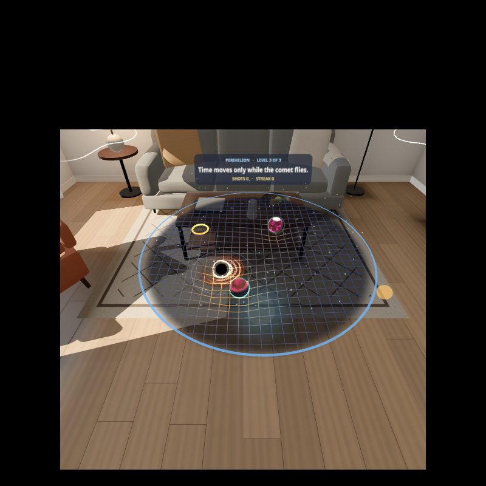 |

| Aiming | In flight |
|---|---|
|  | 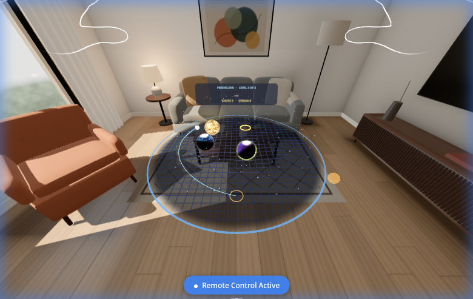 |

<sub>All frames are from the IWSDK browser emulator (Quest 3 profile, emulated hands, synthetic living room).
They are not headset captures.</sub>

## Contents

- [How it plays](#how-it-plays)
- [Architecture](#architecture)
- [Workflows](#workflows)
- [Technical notes](#technical-notes)
- [Visual effects](#visual-effects)
- [Run, test, deploy](#run-test-deploy)
- [Competition requirements](#competition-requirements)
- [Limitations](#limitations)
- [Playtesting without a headset](docs/PLAYTEST.md): simulated players, desktop and webcam play, tuning
- [The physics](docs/PHYSICS.md): what is simulated, what is real, what is stage craft
- [Engineering log](docs/ENGINEERING.md): every problem we hit and how it was solved
- [Build log](#build-log)

## How it plays

- **Hands only.** One verb: pinch, pull, release. No controller, no menus, no buttons inside XR.
- **Seated.** The board is 54 cm across and is placed 45 cm in front of you. Everything is within reach.
- **On your real desk.** In passthrough the board drops onto the nearest horizontal surface at desk height.
  Pinch the amber puck on the rim to drag the board somewhere else.
- **Readable physics.** The grid under the planets sinks where gravity is strong. A dotted line shows the
  start of your shot: long on the first level, short afterwards.
- **A sky that moves when you do.** On the hardest level a moon orbits the primary at Kepler speed, but
  only while the comet is flying. Swing behind it for a real gravity assist.
- **Black holes.** Some levels trade the star for a black hole: nearly twice the pull inside a horizon the
  size of a marble, with an accretion disc and photon ring.
- **The slingshot, in slow motion.** Time slows as the comet makes its closest pass, then the HUD reports
  the perihelion distance and top speed. Your closest winning pass is a personal record.
- **Plant gravity with a pinch.** Pinch the air over the board and a gravity well appears under your
  fingers; the grid sinks and the aiming line bends as you move it. It stays when you let go, can be moved
  mid-flight, and is thrown away by dragging it off the board. One hand at a time is enough.
- **The empty sky.** The second level each day has nothing in it that pulls: one dead rock sits on the
  firing line and the comet flies dead straight into it. There is no solution until you add gravity, with
  a pinch or with a real object from your desk. Elsewhere planted gravity is optional, and a day cleared
  without it earns a gold light.
- **Your desk joins the sky.** The game looks straight down at the desk under the board with depth-based
  hit tests. A mug, a stack of books, anything standing more than 3 cm tall becomes a body with gravity and
  a ring at its base. Move the mug and the puzzle changes.
- **Real things hide virtual things.** With depth sensing, your hands and desk objects occlude the board.
- **Shown, not told.** Before your first shot a ghost performs one winning pull and release on a loop.
- **Three puzzles a day.** The same three skies for everyone, easy to hard. Finish them to grow your streak;
  miss a day and it resets. Each day of the streak adds a light to the far rim (gold for a clean day, blue
  otherwise, up to 30). Encore levels follow.

## Architecture

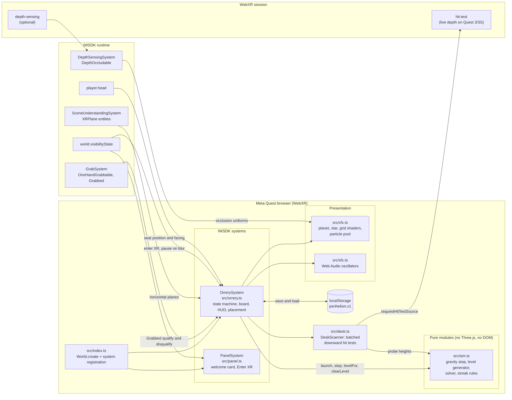

| File | Responsibility |
|---|---|
| `src/sim.ts` | Fixed-step gravity integration, seeded level generator, brute-force solver, day and streak rules, desk-surface and object clustering. Runs unchanged in Node. |
| `src/orrery.ts` | The one gameplay system. Owns the board, the phase state machine, HUD canvas, desk placement and the debug hook. |
| `src/vfx.ts` | Shader materials (planet, atmosphere shell, star, gravity grid) and a fixed-size particle pool. |
| `src/camera-hands.ts` | Webcam hand tracking (MediaPipe) as board pointers, for play without a headset. |
| `src/tuning.ts` | Feel constants and the `?tune=1` slider panel. |
| `src/desk.ts` | `DeskScanner`: 85 downward WebXR hit tests in batches of 10, returning real heights under the board. |
| `src/sfx.ts` | Every sound is one or two oscillators with an envelope. There are no audio files. |
| `src/panel.ts` | Browser welcome card (UIKitML). Hidden while immersive. |
| `src/game-components.ts` | Two tag components: `Comet`, `BoardHandle`. |
| `public/scenes/main.iwsdk.scene.json` | Only the welcome panel. The board is built in code because every level is generated. |
| `test/sim.check.mjs` | Offline self-check of the sim. |
| `test/playtest.mjs` | Simulated players with imprecise hands: shots needed and forgiveness per level. |
| `test/live.*.mjs` | Scripts that drive the running app in the managed emulator. |

## Workflows

### One shot (runtime sequence)

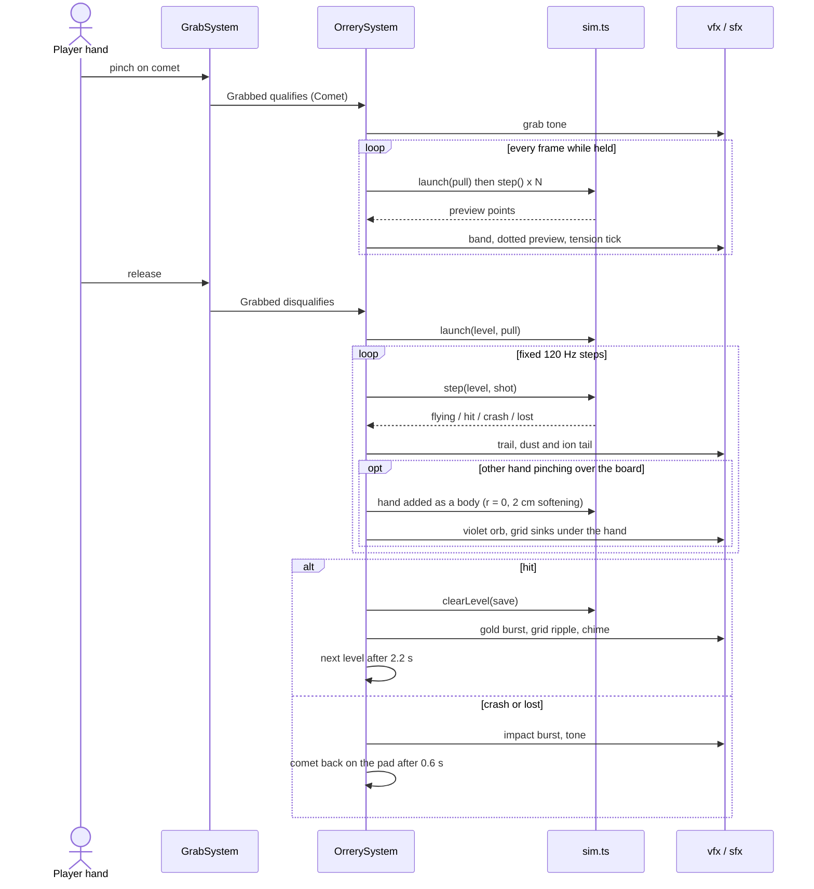

### Game phases

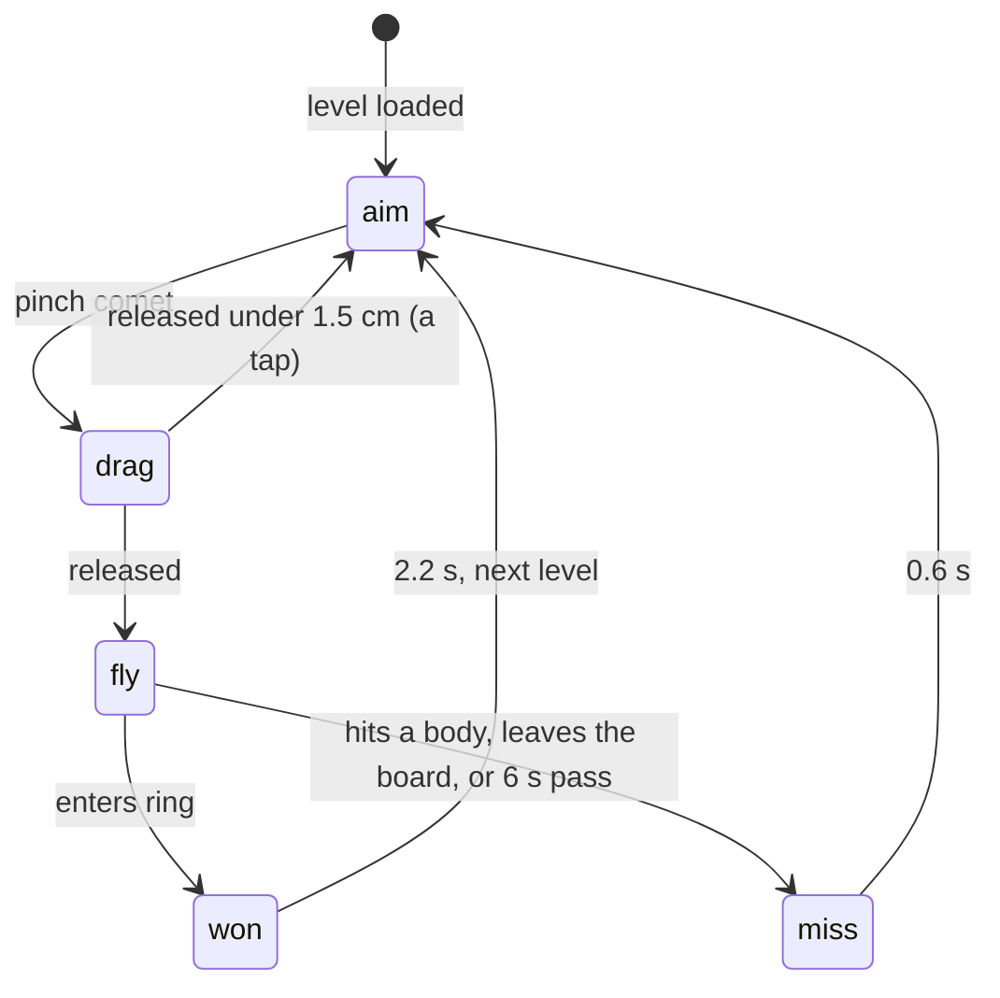

A pinch on the comet while it is in flight is released on the next frame (`GrabSystem.forceRelease`), so the
shot cannot be interrupted.

### Level generation

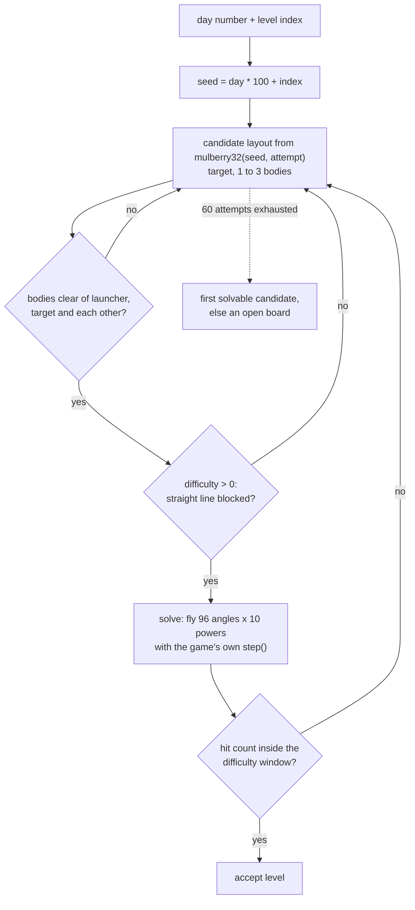

### Desk scan

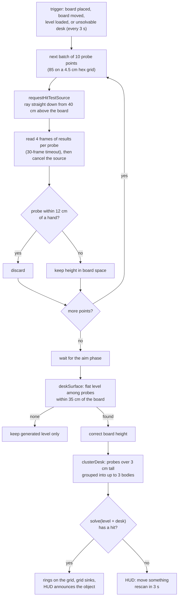

### Development and release

```mermaid
flowchart LR
    A["feature branch<br/>feat/..."] --> B["npm test<br/>sim self-check"]
    B --> C["npm run typecheck"]
    C --> D["iwsdk dev up<br/>managed emulator"]
    D --> E["test/live.hook.mjs<br/>miss, 3 wins, streak"]
    E --> F["xr run-sequence<br/>emulated hand pinch"]
    F --> G["npm run build"]
    G --> H["conventional commit<br/>+ pull request"]
    H --> I["vercel deploy --prod"]
    I --> J["headset check<br/>(not done yet)"]
```

## Technical notes

### Simulation

- Board space is meters on the XZ plane, +z toward the player. The comet moves in that plane.
- Acceleration is the sum over bodies of `gm * d / (|d|^2 + 1e-5)^(3/2)` (softened Newtonian gravity),
  integrated with semi-implicit Euler at a fixed `DT = 1/120 s`.
- Launch speed is `3.2 m/s` per meter of pull, pull clamped to 16 cm, so the fastest shot is 0.51 m/s and a
  board crossing takes about a second. The long draw was chosen from the simulated playtest: it makes each
  millimetre of hand error matter less.
- The pull is low-pass filtered over 80 ms, and the launch uses the filtered value the preview was drawn
  from, so the twitch of opening the fingers does not aim the shot.
- Orbiting bodies are posed from the shot's elapsed time inside `step()`, so solver, preview and flight
  agree on where a moon is.
- Near the primary the runtime feeds less frame time to the accumulator (slow motion). The steps, and so
  the path, are unchanged.
- A shot ends on `hit` (inside the 3 cm ring), `crash` (inside a body), or `lost` (8 cm past the rim, or 6 s).
- The runtime accumulates frame time and advances in whole `DT` steps, capped at 0.1 s per frame. The solver
  uses the same `step()`, so any launch the solver found replays exactly in the game at any frame rate.

### Levels and difficulty

| Daily level | Bodies | Straight shot | Solver hits allowed (of 960) |
|---|---|---|---|
| 1 | 1 (a star) | may work | 25 or more |
| 2, empty sky | 1 rock with no gravity | blocked, and nothing bends: 0 | 6 or more once gravity is planted at the helper spot |
| 3 and encore | 3, one usually a moon in orbit | blocked | 6 to 90 |

Every accepted level must also have a *forgiving* answer: a winning launch whose neighbours on the solver
grid (one step of angle or power either way) win too. Every third encore level is an empty sky.

The heaviest body is the primary: a star, or on levels 2 and up a black hole 40% of the time. Other
bodies are planets lit from it. Moons move only while the comet flies, so levels stay deterministic; see
[the physics](docs/PHYSICS.md).

### Day and streak

- The day number is the local calendar date, so a new set appears at local midnight.
- `openDay` resets progress on a new day and zeroes the streak if a day was skipped.
- `clearLevel` adds one to the streak the first time the third level is cleared that day.
- Save shape (`localStorage["perihelion.v1"]`): `{ lastDay, streak, day, index, shots, todayShots, nudged, log }`.
  `log` holds one entry per day of the current streak (1 = cleared, 2 = cleared without hand gravity).
  If storage is blocked the game still runs, without persistence.

### Hand interaction

- The comet and the rim puck are `OneHandGrabbable` entities. IWSDK maps a hand pinch to that grab by
  default, and a controller squeeze works too, so no controller is required and none is excluded.
- The comet's grab volume (2.8 cm radius) is larger than its visible core, so a loose pinch still catches it.
- The pull vector is read in board space, so it stays correct after the board is moved or turned.

### Planted gravity

- In any phase but the win, a pinch (`gamepads[side].getSelecting()`) over the board plants a well at the
  index tip, in board space. A pinch within 5 cm of the pad is left to the comet grab, and a hand already
  holding the comet or the rim puck is ignored (`GrabSystem.getHolderHand`).
- The well persists after the pinch ends. Pinching again moves it; dragging it 4 cm past the rim removes it.
- It is a body with `gm = 0.006` (a mid-sized planet), no crash radius, and a 2 cm softening so a comet
  passing through it is not flung away. The aiming preview and the live flight include it.
- On ordinary levels the generator never sees it, so it is an aid and costs the day's gold light. On
  empty-sky levels it is required and costs nothing.

### Empty-sky levels

`generateVoid` places one rock (`gm = 0`) on the firing line. With no gravity anywhere the comet flies
straight, so the level is checked to have **zero** winning launches. It is then accepted only if a planted
well at one of four spots beside the rock gives at least six winning launches with a forgiving answer; the
best spot is stored as `helper` and shown as a hint ring after two misses.

### Onboarding ghost

On the first level, until the first shot of the day, the system takes one launch from the solver, records
its path, and loops a 3.4 s demo: a cue closes on the comet like a pinch, a ghost comet is pulled back along
that launch with the band drawn, then the ghost flies the recorded path into the ring. Grabbing the comet
hides it.

### Real desk objects

- On Quest 3 and 3S (Horizon Browser 40.4+) WebXR hit tests are answered from the live depth map rather
  than the saved room mesh. A ray cast straight down therefore lands on whatever is really there now.
- `DeskScanner` never holds more than 10 hit-test sources open and finishes a scan in about a second.
- `deskSurface` and `clusterDesk` are pure and covered by `npm test`, including a board that overhangs the
  desk edge and a single noisy probe.
- An object needs two adjacent probes at least 3.5 cm tall, and two scans in a row that agree on where it
  is. Under simulated depth noise (1.2 cm jitter, 3% outliers of 5 cm) a single scan invents an object
  about 1 time in 9; requiring agreement brought that to 0 in 300 trials while keeping a real mug in 299.
- A found body has `r` from its footprint (at most 7 cm), `gm` from its probe count (0.0055 to 0.012), and
  `real: true`. It is not drawn; it gets a ring. The aiming preview, the ghost and the solver all use the
  generated level plus the desk; the hand is added only for the live flight.
- If the session refuses a hit-test source, the scanner marks itself unsupported and the game continues
  with generated bodies only. `?desk=0` turns the scan off.

### Depth occlusion

- `depth-sensing` is requested as an optional feature (`gpu-optimized`, `float32`) and IWSDK's
  `DepthSensingSystem` is registered. The board root and the rim puck carry `DepthOccludable`.
- Custom shaders are made compatible in `src/vfx.ts` (`occlude()`); the reasons are in the
  [engineering log](docs/ENGINEERING.md#13-occlusion-ignored-our-shaders).
- `?occlusion=hard` switches to single-tap occlusion; `?occlusion=0` turns it off.

### Desk placement

1. About 0.6 s after the session becomes visible, the board is placed 45 cm ahead of the head along its
   flattened forward direction, 45 cm below eye height, turned to face the player.
2. Among detected `XRPlane` entities, horizontal planes 20 to 90 cm below the head and within 70 cm of the
   board are candidates; the board drops onto the nearest. Planes that arrive in the next 8 s are also used.
3. The desk scan then measures the real surface under the board from live depth and corrects the height.
4. Dragging the rim puck moves the board, ends plane snapping, and triggers a new scan.

The plane test uses each plane's center, not its outline. A very large desk whose center is far away is
missed; the rim puck covers that case.

### Field of view

Meta VR devices differ in field of view. The narrowest target, Meta VR Glasses, shows 37° to each side,
25° above and 43° below the view axis. Looking at the board's centre from the default seat (pitch 39°
down), every essential element sits inside that:

| Element | Horizontal | Vertical | Limit |
|---|---|---|---|
| Board, left and right edge | ±24.9° | 0° | ±37° |
| Board, near edge | 0° | −24.6° | −43° |
| Comet at full pull-back (16 cm) | 0° | −29.9° | −43° |
| Board, far edge and streak lights | 0° | +12.8° | +25° |
| HUD, top corners | ±13.7° | about +18° | +25° |
| Rim puck | +27.7° | −11.4° | ±37° |

Angles are computed from the runtime board and head positions, against the view axis. The emulator's
glasses profile confirms it: nothing is clipped by the mask.


<sub>IWSDK emulator, Meta VR Glasses profile. Black is outside the device's view. Captured before the HUD
was lowered by 2.5 cm for extra margin.</sub>

The game uses near pinch, not gaze, so it needs no gaze-specific handling; an emulated hand pinch, pull and
release was run under the glasses profile and launched normally.

### Pause and resume

While `visibilityState` is `VisibleBlurred` (system menu open) the system skips its update, so a shot in
flight freezes and continues afterwards.

### Render cost

Measured with `test/live.render.mjs` (desktop emulator, one view): 22 to 28 draw calls and 22,000 to 32,000
triangles per frame across the three daily levels. Meta's published guidance for Quest 3 is under 200 draw
calls and under 1.5 million triangles. Stereo rendering doubles our numbers at most. This is a budget
check, not a frame-rate measurement; shader cost is not captured by it.

### Debug hook

`window.__perihelion` exposes `state()`, `shoot(px, pz)`, `solve()`, `desk()`, `place()`, `scan()`, `lastScan()`, `feed(samples)`, `load(day, index)`, `pointer(id, x, z, down)` and `toScreen(x, z)`. The live test scripts use it. It
does not change game rules.

## Visual effects

Nothing is loaded from disk: every surface is a shader or a canvas texture.

| Effect | Technique |
|---|---|
| Planets | Four-octave value noise sampled on the undeformed sphere direction; gas giants add warped latitude bands, rocky worlds get land masks and pale poles. A soft terminator is lit from the level's star. |
| Atmosphere | A fresnel rim on the surface plus a second, 20% larger back-face sphere with additive blending, brightest at the limb and on the day side. |
| Star | Two animated noise fields for granulation and flares, with limb darkening. The corona is a billboard sprite. |
| Gravity grid | An 88 x 88 plane whose vertices sink by the same `gm / r` potential the sim integrates. Grid lines are anti-aliased with `fwidth`. A hit sends one ripple out from the ring. |
| Comet | Two tails, as on a real comet: dust lags along the path, ions blow straight away from the star and strengthen near it. |
| Black hole | Black horizon sphere, flat disc shader with Keplerian shear, `r^-3/4` temperature colour and a Doppler-bright side, plus a billboard photon ring. Painted, not ray-traced. |
| Bursts | Launch sparks, crash debris and the win burst all come from one pool of 384 points that never allocates. |

Choices made for Quest hardware:

- **Self-governing frame rate.** If frames average under 55 fps for three seconds, real-world occlusion
  steps from 13 depth taps to 1, then off.
- **No post-processing.** Meta's guidance is that true bloom is too expensive on mobile VR and that
  billboarded blob sprites get close, so every glow here is an additive sprite.
- **Little transparent overdraw.** Particles are small points; the grid is the only large transparent surface.
- **Passthrough-safe additive blending.** Additive shaders write their intensity to alpha. Writing alpha 1
  made the compositor treat each particle as an opaque black square over the real room.

References studied: Meta's [WebXR performance best practices](https://developers.meta.com/horizon/documentation/web/webxr-perf-bp/)
and [PC rendering techniques to avoid on mobile VR](https://developers.meta.com/horizon/blog/pc-rendering-techniques-to-avoid-when-developing-for-mobile-vr/),
and community write-ups of the fresnel-rim-plus-back-face-shell atmosphere.

## Run, test, deploy

Needs Node 22.18+ (or 24).

```bash
npm install
npm run dev          # managed browser with the XR emulator
npm test             # sim self-check
npm run playtest     # simulated players: shots needed, forgiveness
npm run typecheck
npm run build        # static site in dist/
```

**Offline check (`npm test`).** Generates 120 levels (30 days x 4), asserts each is deterministic and
solvable and that the solver's answer replays as a hit, then walks the streak rules through a finished day,
the next day and a skipped day.

**Live checks.** Start the dev server with automation enabled, then run a script:

```bash
npx @iwsdk/cli dev up --allow-browser-automation
npx @iwsdk/cli browser run test/live.hook.mjs    # miss, three wins, streak, persistence
npx @iwsdk/cli browser run test/live.nudge.mjs   # with an emulated hand pinching over the board: hand gravity is live
```

The real input path is exercised with an emulated hand:

```bash
npx @iwsdk/cli xr enter --input-json '{}'
npx @iwsdk/cli xr set-input-mode --input-json '{"mode":"hand"}'
npx @iwsdk/cli xr run-sequence --input-json '{"device":"hand-right","steps":[
  {"position":{"x":0,"y":1.21,"z":-0.26},"pinch":{"value":1,"at":"arrival"}},
  {"position":{"x":0.01,"y":1.21,"z":-0.185},"duration":0.8},
  {"pinch":0,"duration":0.15}]}'
```

**Deploy.** The build is a static site with relative asset paths.

```bash
vercel deploy --prod
```

To test on a headset during development, open the dev server's HTTPS URL in the Quest browser.

## Competition requirements

| Requirement or guideline | How Perihelion meets it |
|---|---|
| Hands-first, end to end | The browser card is tapped with a hand pinch like any web page; inside XR, pinch to play and pinch to move the board. No controller is ever needed. |
| Seated, two-foot radius | 54 cm board placed 45 cm ahead; a full draw is 16 cm and ends 14 cm short of the body. |
| A complete moment in under ten minutes | Three daily levels; each shot resolves in at most 6 s. |
| Original, not a wrapper | No third-party service. No network calls after the page loads. |
| Purposeful passthrough | The board sits on the real desk at its measured height; real objects on it are bodies in the simulation; real things occlude virtual ones. One level a day cannot be solved without gravity the player adds, by hand or with a real object. |
| Holds up in untested rooms | Height comes from live depth, not only stored planes; no room setup is needed for the scan; every real-world feature degrades to off if its session feature is missing. |
| Accessible by default | One gesture (pinch), one hand at a time; planted gravity stays put, so nothing needs two hands or fast timing. Playable with a mouse. |
| Reason to come back | New seeded set each local day, streak, shots-to-finish for the day, a rim of lights that grows per day and rewards clean clears, and a closest-pass record to beat. |

## Limitations

- **Not yet tested on a physical headset.** Pinch feel, plane snapping on a real desk and frame rate on
  Quest hardware are unverified. In the emulator, seated at its coffee table, plane snapping and the
  depth correction both ran (0.424 m, then 0.440 m).
- The field-of-view check assumes the default seat. A player sitting much closer, or with the board
  dragged far to one side, can push the rim puck or HUD out of a narrow view.
- Frame rate has not been profiled. The 60 fps minimum is a target, not a measurement.
- The streak is stored per browser. Clearing site data resets it; there is no account or leaderboard.
- The particle size constant is hand-tuned in the emulator and may need retuning on device.
- Planted gravity is verified with an emulated pinch and with a mouse; how it feels with real tracking
  jitter is unknown.
- Webcam hand tracking has not been run by us (no camera on the build machine). It shares all game-side
  code with the tested mouse path.
- The empty-sky level is the hardest for the simulated player (23% gave up within 15 shots).
- Depth occlusion and the desk scan are verified against the emulator's clean depth and geometry only.
  Real depth is noisier; thresholds and batch sizes are educated guesses. Escape hatches: `?desk=0`,
  `?occlusion=0`, `?occlusion=hard`.
- Desk objects are approximated as circles and capped at three.
- No voice alternative or high-contrast mode yet.

## Build log

**Nov 12, 2026**
- IWSDK AR starter scaffolded; starter demo content removed.
- `sim.ts`: gravity step, seeded generator, solver, streak rules, with the offline check.
- `orrery.ts`: board, pinch slingshot, preview, trail, HUD, desk placement, rim puck, save.
- Live verification in the emulator: hook scenario and emulated hand pinch.
- `vfx.ts`: shader planets, star, gravity grid, comet tails, bursts; passthrough alpha fix.
- Deployed to Vercel.
- Hand gravity, onboarding ghost and streak lights.
- Depth occlusion for all materials including custom shaders.
- Desk scan: real objects become gravity bodies; board height corrected from live depth.
- Engineering log written.
- Orbiting moons, black holes, slow-motion passes, perihelion telemetry, frame-rate governor.
- Physics explainer written.
- Field-of-view pass with the Meta VR Glasses emulator profile; HUD lowered.
- Simulated playtest written; draw lengthened, ring widened, forgiving answers required.
- Planted gravity and empty-sky levels; mouse, webcam and tuning play without a headset.
- Desk scan hardened against depth noise with two-scan agreement.
