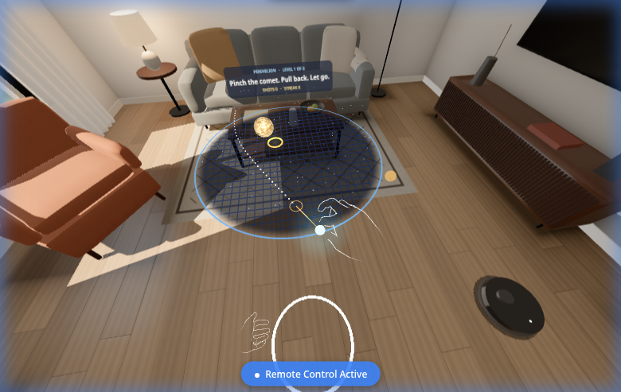
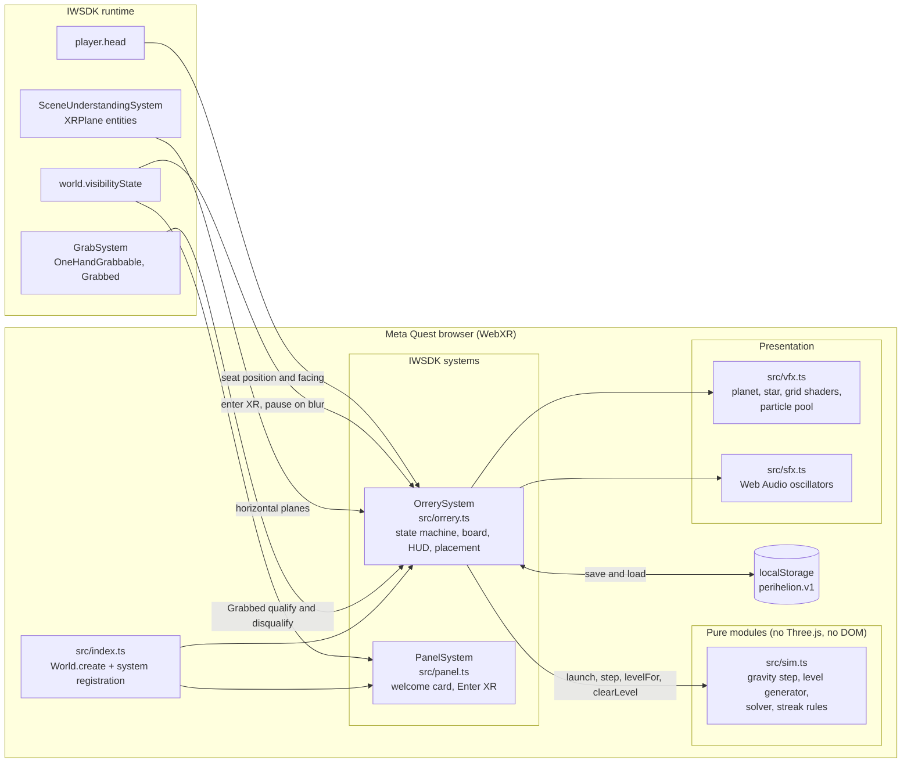
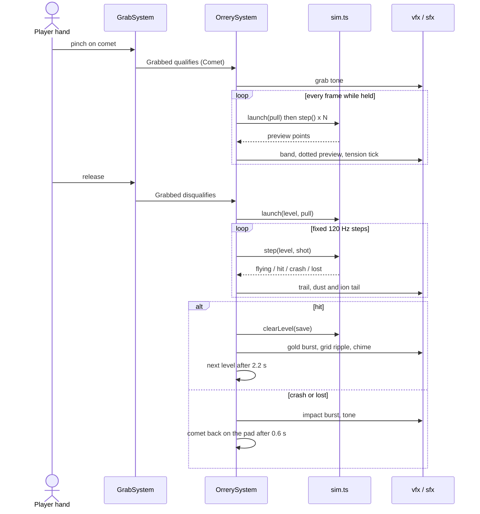
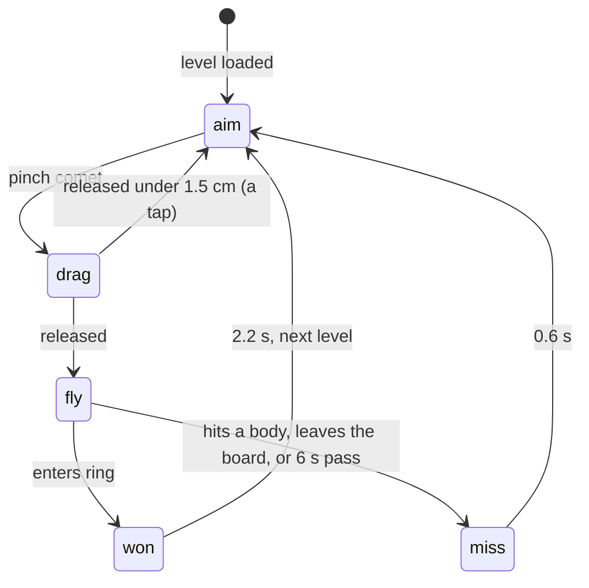
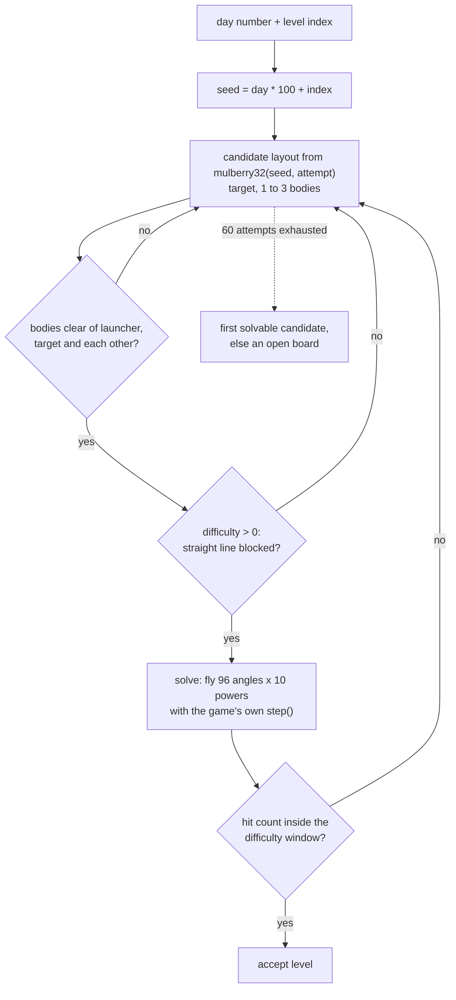

# Perihelion

**A daily gravity puzzle that lives on your desk.** Pinch the comet, pull back, let go — and bend its path
around a star and its planets into the ring.

- **Play:** https://perihelion-three.vercel.app (open in the Meta Quest browser, tap *Play on your desk*)
- **Built for:** Meta VR Start Developer Competition 2026 — Gaming track, New Experience
- **Built with:** [Immersive Web SDK](https://developers.meta.com/horizon/documentation/iwsdk/guides/overview/) 1.1 (WebXR, Three.js, ECS), TypeScript, Vite

| Aiming | In flight |
|---|---|
|  |  |

<sub>Both frames are from the IWSDK browser emulator (Quest 3 profile, emulated hands, synthetic living room).
They are not headset captures.</sub>

## Contents

- [How it plays](#how-it-plays)
- [Architecture](#architecture)
- [Workflows](#workflows)
- [Technical notes](#technical-notes)
- [Visual effects](#visual-effects)
- [Run, test, deploy](#run-test-deploy)
- [Competition requirements](#competition-requirements)
- [Limitations](#limitations)
- [Build log](#build-log)

## How it plays

- **Hands only.** One verb: pinch, pull, release. No controller, no menus, no buttons inside XR.
- **Seated.** The board is 54 cm across and is placed 45 cm in front of you. Everything is within reach.
- **On your real desk.** In passthrough the board drops onto the nearest horizontal surface at desk height.
  Pinch the amber puck on the rim to drag the board somewhere else.
- **Readable physics.** The grid under the planets sinks where gravity is strong. A dotted line shows the
  start of your shot: long on the first level, short afterwards.
- **Three puzzles a day.** The same three skies for everyone, easy to hard. Finish them to grow your streak;
  miss a day and it resets. Encore levels follow.

## Architecture



| File | Responsibility |
|---|---|
| `src/sim.ts` | Fixed-step gravity integration, seeded level generator, brute-force solver, day and streak rules. Runs unchanged in Node. |
| `src/orrery.ts` | The one gameplay system. Owns the board, the phase state machine, HUD canvas, desk placement and the debug hook. |
| `src/vfx.ts` | Shader materials (planet, atmosphere shell, star, gravity grid) and a fixed-size particle pool. |
| `src/sfx.ts` | Every sound is one or two oscillators with an envelope. There are no audio files. |
| `src/panel.ts` | Browser welcome card (UIKitML). Hidden while immersive. |
| `src/game-components.ts` | Two tag components: `Comet`, `BoardHandle`. |
| `public/scenes/main.iwsdk.scene.json` | Only the welcome panel. The board is built in code because every level is generated. |
| `test/sim.check.mjs` | Offline self-check of the sim. |
| `test/live.*.mjs` | Scripts that drive the running app in the managed emulator. |

## Workflows

### One shot (runtime sequence)



### Game phases



A pinch on the comet while it is in flight is released on the next frame (`GrabSystem.forceRelease`), so the
shot cannot be interrupted.

### Level generation



### Development and release

```mermaid
flowchart LR
    A["feature branch<br/>feat/..."] --> B["npm test<br/>sim self-check"]
    B --> C["npm run typecheck"]
    C --> D["iwsdk dev up<br/>managed emulator"]
    D --> E["test/live.hook.mjs<br/>miss, 3 wins, streak"]
    E --> F["xr run-sequence<br/>emulated hand pinch"]
    F --> G["npm run build"]
    G --> H["conventional commit<br/>+ pull request"]
    H --> I["vercel deploy --prod"]
    I --> J["headset check<br/>(not done yet)"]
```



## Technical notes

### Simulation

- Board space is meters on the XZ plane, +z toward the player. The comet moves in that plane.
- Acceleration is the sum over bodies of `gm * d / (|d|^2 + 1e-5)^(3/2)` (softened Newtonian gravity),
  integrated with semi-implicit Euler at a fixed `DT = 1/120 s`.
- Launch speed is `5 m/s` per meter of pull, pull clamped to 10 cm, so the fastest shot is 0.5 m/s and a
  board crossing takes about a second.
- A shot ends on `hit` (inside the 2.2 cm ring), `crash` (inside a body), or `lost` (8 cm past the rim, or 6 s).
- The runtime accumulates frame time and advances in whole `DT` steps, capped at 0.1 s per frame. The solver
  uses the same `step()`, so any launch the solver found replays exactly in the game at any frame rate.

### Levels and difficulty

| Daily level | Bodies | Straight shot | Solver hits allowed (of 960) |
|---|---|---|---|
| 1 | 1 (a star) | may work | 25 or more |
| 2 | 2 | blocked | 6 to 70 |
| 3 and encore | 3 | blocked | 3 to 45 |

The heaviest body in a level is drawn as the star; the others are planets lit from it.

### Day and streak

- The day number is the local calendar date, so a new set appears at local midnight.
- `openDay` resets progress on a new day and zeroes the streak if a day was skipped.
- `clearLevel` adds one to the streak the first time the third level is cleared that day.
- Save shape (`localStorage["perihelion.v1"]`): `{ lastDay, streak, day, index, shots, todayShots }`.
  If storage is blocked the game still runs, without persistence.

### Hand interaction

- The comet and the rim puck are `OneHandGrabbable` entities. IWSDK maps a hand pinch to that grab by
  default, and a controller squeeze works too, so no controller is required and none is excluded.
- The comet's grab volume (2.8 cm radius) is larger than its visible core, so a loose pinch still catches it.
- The pull vector is read in board space, so it stays correct after the board is moved or turned.

### Desk placement

1. About 0.6 s after the session becomes visible, the board is placed 45 cm ahead of the head along its
   flattened forward direction, 45 cm below eye height, turned to face the player.
2. Among detected `XRPlane` entities, horizontal planes 20 to 90 cm below the head and within 70 cm of the
   board are candidates; the board drops onto the nearest. Planes that arrive in the next 8 s are also used.
3. Dragging the rim puck moves the board and ends automatic snapping.

The plane test uses each plane's center, not its outline. A very large desk whose center is far away is
missed; the rim puck covers that case.

### Pause and resume

While `visibilityState` is `VisibleBlurred` (system menu open) the system skips its update, so a shot in
flight freezes and continues afterwards.

### Debug hook

`window.__perihelion` exposes `state()`, `shoot(px, pz)` and `solve()`. The live test scripts use it. It
does not change game rules.

## Visual effects

Nothing is loaded from disk: every surface is a shader or a canvas texture.

| Effect | Technique |
|---|---|
| Planets | Four-octave value noise sampled on the undeformed sphere direction; gas giants add warped latitude bands, rocky worlds get land masks and pale poles. A soft terminator is lit from the level's star. |
| Atmosphere | A fresnel rim on the surface plus a second, 20% larger back-face sphere with additive blending, brightest at the limb and on the day side. |
| Star | Two animated noise fields for granulation and flares, with limb darkening. The corona is a billboard sprite. |
| Gravity grid | An 88 x 88 plane whose vertices sink by the same `gm / r` potential the sim integrates. Grid lines are anti-aliased with `fwidth`. A hit sends one ripple out from the ring. |
| Comet | Two tails, as on a real comet: dust lags along the path, ions blow straight away from the star and strengthen near it. |
| Bursts | Launch sparks, crash debris and the win burst all come from one pool of 384 points that never allocates. |

Choices made for Quest hardware:

- **No post-processing.** Meta's guidance is that true bloom is too expensive on mobile VR and that
  billboarded blob sprites get close, so every glow here is an additive sprite.
- **Little transparent overdraw.** Particles are small points; the grid is the only large transparent surface.
- **Passthrough-safe additive blending.** Additive shaders write their intensity to alpha. Writing alpha 1
  made the compositor treat each particle as an opaque black square over the real room.

References studied: Meta's [WebXR performance best practices](https://developers.meta.com/horizon/documentation/web/webxr-perf-bp/)
and [PC rendering techniques to avoid on mobile VR](https://developers.meta.com/horizon/blog/pc-rendering-techniques-to-avoid-when-developing-for-mobile-vr/),
and community write-ups of the fresnel-rim-plus-back-face-shell atmosphere.

## Run, test, deploy

Needs Node 22.18+ (or 24).

```bash
npm install
npm run dev          # managed browser with the XR emulator
npm test             # sim self-check
npm run typecheck
npm run build        # static site in dist/
```

**Offline check (`npm test`).** Generates 120 levels (30 days x 4), asserts each is deterministic and
solvable and that the solver's answer replays as a hit, then walks the streak rules through a finished day,
the next day and a skipped day.

**Live checks.** Start the dev server with automation enabled, then run a script:

```bash
npx @iwsdk/cli dev up --allow-browser-automation
npx @iwsdk/cli browser run test/live.hook.mjs    # miss, three wins, streak, persistence
```

The real input path is exercised with an emulated hand:

```bash
npx @iwsdk/cli xr enter --input-json '{}'
npx @iwsdk/cli xr set-input-mode --input-json '{"mode":"hand"}'
npx @iwsdk/cli xr run-sequence --input-json '{"device":"hand-right","steps":[
  {"position":{"x":0,"y":1.21,"z":-0.26},"pinch":{"value":1,"at":"arrival"}},
  {"position":{"x":0.01,"y":1.21,"z":-0.185},"duration":0.8},
  {"pinch":0,"duration":0.15}]}'
```

**Deploy.** The build is a static site with relative asset paths.

```bash
vercel deploy --prod
```

To test on a headset during development, open the dev server's HTTPS URL in the Quest browser.

## Competition requirements

| Requirement or guideline | How Perihelion meets it |
|---|---|
| Hands-first, end to end | The browser card is tapped with a hand pinch like any web page; inside XR, pinch to play and pinch to move the board. No controller is ever needed. |
| Seated, two-foot radius | 54 cm board placed 45 cm ahead; the pull is at most 10 cm. |
| A complete moment in under ten minutes | Three daily levels; each shot resolves in at most 6 s. |
| Original, not a wrapper | No third-party service. No network calls after the page loads. |
| Purposeful passthrough | The board sits on the player's real desk and is reached for like an object on it. |
| Reason to come back | New seeded set each local day, streak, shots-to-finish for the day. |

## Limitations

- **Not yet tested on a physical headset.** Pinch feel, plane snapping on a real desk and frame rate on
  Quest hardware are unverified. In the emulator's room no plane fell inside the desk-height window, so the
  snap path has run only as a no-op there.
- Frame rate has not been profiled. The 60 fps minimum is a target, not a measurement.
- The streak is stored per browser. Clearing site data resets it; there is no account or leaderboard.
- The particle size constant is hand-tuned in the emulator and may need retuning on device.
- No accessibility options yet (no voice alternative, no high-contrast mode).

## Build log

**Nov 12, 2026**
- IWSDK AR starter scaffolded; starter demo content removed.
- `sim.ts`: gravity step, seeded generator, solver, streak rules, with the offline check.
- `orrery.ts`: board, pinch slingshot, preview, trail, HUD, desk placement, rim puck, save.
- Live verification in the emulator: hook scenario and emulated hand pinch.
- `vfx.ts`: shader planets, star, gravity grid, comet tails, bursts; passthrough alpha fix.
- Deployed to Vercel.
